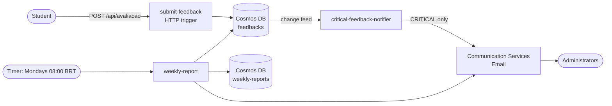

# Feedback Platform — FIAP Pós Tech · Phase 4 Tech Challenge

Serverless platform where students rate classes and administrators receive critical-feedback alerts and a
weekly report. Built with **Java 21 + Spring Cloud Function on Azure Functions**.

> 🚧 Work in progress — sections below are filled in as each phase is delivered.

## Table of contents
1. [Cloud model and components](#cloud-model-and-components)
2. [Solution architecture](#solution-architecture)
3. [Serverless functions](#serverless-functions)
4. [API](#api)
5. [Security and governance](#security-and-governance)
6. [Monitoring](#monitoring)
7. [Running locally](#running-locally)
8. [Deploy](#deploy)
9. [Project structure](#project-structure)

## Cloud model and components
_TODO (phase 8)._

## Solution architecture


## Serverless functions
| Function | Trigger | Single responsibility |
|---|---|---|
| `submit-feedback-function` | HTTP `POST /api/avaliacao` | Validate, classify urgency and persist a feedback |
| `critical-feedback-notifier-function` | Cosmos DB change feed | E-mail administrators about critical feedback |
| `weekly-report-function` | Timer (weekly) | Build the weekly report, store it and e-mail it |

## API
```http
POST /api/avaliacao
Content-Type: application/json

{ "descricao": "string", "nota": 0..10 }
```
Urgency: `0–3 → CRITICAL`, `4–6 → MEDIUM`, `7–10 → LOW`.
The route is `/avaliacao` (without the accent from the challenge statement) to keep the URL ASCII-safe.

## Security and governance
_TODO (phase 6/8)._

## Monitoring
_TODO (phase 6/8)._

## Running locally
Everything runs on local emulators — no Azure subscription needed.

**Requirements:** JDK 21+, Maven 3.9+, Docker, [Azure Functions Core Tools v4](https://learn.microsoft.com/azure/azure-functions/functions-run-local)
(macOS: `brew tap azure/functions && brew install azure-functions-core-tools@4`).

```bash
# 1. Build and run all tests
mvn clean verify

# 2. Start the emulators (Cosmos DB vNext + Azurite)
docker compose up -d

# 3. Local settings (gitignored). Contains only the public, well-known emulator key.
cp submit-feedback-function/local.settings.example.json submit-feedback-function/local.settings.json

# 4. Run the function — http://localhost:7071/api/avaliacao
mvn -pl submit-feedback-function -am install -DskipTests
mvn -pl submit-feedback-function azure-functions:run
```

Quick check:
```bash
curl -i -X POST http://localhost:7071/api/avaliacao \
  -H "Content-Type: application/json" \
  -d '{"descricao": "Áudio inaudível durante a aula", "nota": 2}'
```
Stored documents can be browsed in the emulator's Data Explorer: http://localhost:1234.

**Postman:** import `docs/postman/feedback-platform.postman_collection.json` and the `local` environment, then run
the collection in folder order (Collection Runner). Function keys are not enforced locally, so `functionKey` stays empty.

## Deploy
_TODO (phase 6/7)._

## Project structure
```
feedback-core/                         shared domain, no cloud dependencies
submit-feedback-function/              function 1
critical-feedback-notifier-function/   function 2
weekly-report-function/                function 3
infra/                                 Bicep templates
docs/                                  diagrams, video script, Postman collection
.github/workflows/                     CI and deploy pipelines
```
